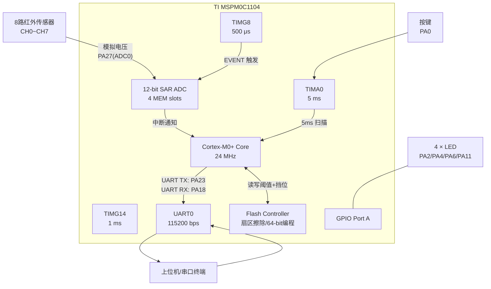
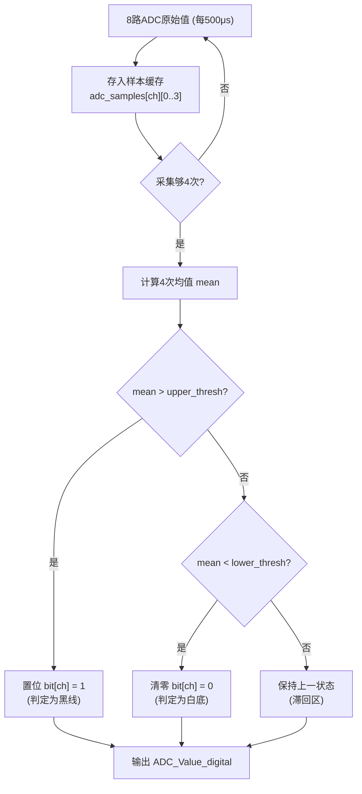
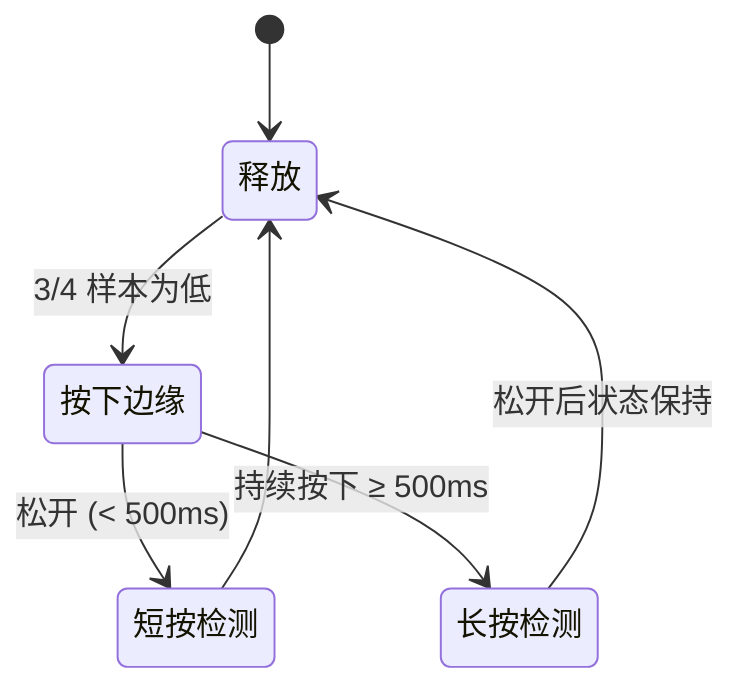
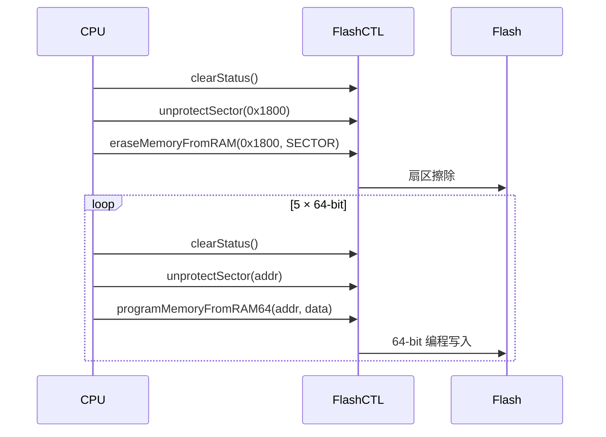
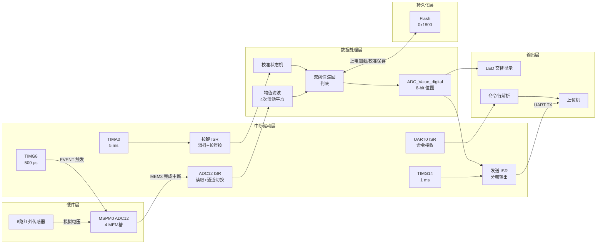

# 基于 TI MSPM0C1104 的 8 路巡线传感器采集与标定系统 — 原理报告

---

## 1. 系统概述

本系统以 **德州仪器（Texas Instruments）MSPM0C1104** 微控制器为核心，实现了一套完整的 **8 路红外巡线传感器** 模拟信号采集、数字判决、阈值标定与串口通信方案。MSPM0C1104 是 TI 推出的 MSPM0 系列中的高性价比型号，基于 **Arm Cortex-M0+ 内核**，主频高达 **24 MHz**，内置 12 位 SAR ADC、多路通用定时器及 UART 等丰富外设，非常适用于传感器数据采集与嵌入式控制场景。

本设计采用 **NoRTOS（裸机）架构**，所有实时任务均通过中断服务例程（ISR）调度，具有响应快、代码量小、功耗低的特点，适合资源受限的嵌入式应用。

---

## 2. MSPM0C1104 芯片特性概述

| 参数 | 规格 |
|------|------|
| **内核** | Arm Cortex-M0+ |
| **最高主频** | 24 MHz |
| **Flash** | 16 KB |
| **SRAM** | 1 KB |
| **ADC** | 12 位 SAR ADC，最高 1.45 Msps，多达 10 个外部通道 |
| **定时器** | 多路通用计时器（TIMG/TIMA） |
| **通信接口** | UART、I2C、SPI |
| **GPIO** | 多达 20 个 I/O 引脚 |
| **封装** | VSSOP-20 (DGS20) |
| **工作电压** | 1.62 V – 3.6 V |

MSPM0C1104 具有 **零引脚冲突（pin-to-pin compatible）** 的封装设计，配合 TI 的 **SysConfig 图形化配置工具**，可大幅简化引脚复用与外设初始化工作，降低硬件设计的复杂度。

---

## 3. 系统硬件架构

---

## 4. 外设资源分配与工作原理

### 4.1 ADC12 — 12 位逐次逼近型模数转换器

MSPM0C1104 内置的 12 位 SAR ADC 是本系统的核心外设。其工作配置如下：

| 配置项 | 设定值 | 说明 |
|--------|--------|------|
| **工作模式** | 序列模式 (Sequence) | 一次触发依次转换 4 个 MEM 槽 |
| **触发源** | EVENT（来自 TIMG8） | 由定时器事件自动触发，无需 CPU 干预 |
| **分辨率** | 12 位 | 0–4095 量化范围 |
| **参考电压** | VDDA (3.3 V) | 使用模拟电源电压作为参考 |
| **采样时间** | 83 ns | 满足传感器输出建立时间 |
| **转换槽数** | 4 个 (MEM0–MEM3) | 每个槽可独立配置输入通道 |
| **中断** | MEM3 转换完成 | 序列最后一个槽完成后触发中断 |

**8 通道采集策略：**

由于 MSPM0C1104 每个 ADC 实例仅有 4 个结果存储槽（MEM0–MEM3），而本系统需要采集 8 路传感器信号，因此采用 **分时复用** 策略：

| 轮次 | MEM0 | MEM1 | MEM2 | MEM3 |
|------|------|------|------|------|
| **奇数轮** | CH5 | CH0 | CH1 | CH2 |
| **偶数轮** | CH3 | CH4 | CH9 | CH8 |

每次 ADC 中断时，先读取当前轮次的 4 个通道结果，然后通过 `DL_ADC12_configConversionMem()` 动态切换各 MEM 槽对应的输入通道号，实现 4 个物理槽对 8 个逻辑通道的覆盖。每轮采集间隔为 **500 μs**，完成一轮 8 通道采集耗时 **1 ms**。

### 4.2 定时器系统

本系统使用了 3 个通用定时器，各自承担不同的实时任务：

#### TIMG14 (TIMER_0) — 1 ms 时基定时器

| 参数 | 值 |
|------|-----|
| **工作模式** | 周期性 (Periodic) |
| **周期** | 1 ms |
| **时钟分频** | ÷8 ÷32 = ÷256 |
| **加载值** | 93 |
| **中断** | 过零事件 (ZERO) |

**功能**：提供系统时间基准。在 ISR 中实现：
- **UART 数据发送分频**：以 1 ms tick 累加，达到预设发送间隔（如 10 ms）后发送一帧 `ADC_Value_digital` 字节
- **校准超时计时**：校准完成后 LED 全亮持续 1 秒（1000 ticks = 1 s），然后自动退出校准状态

#### TIMG8 (TIMER_1) — 500 μs ADC 触发定时器

| 参数 | 值 |
|------|-----|
| **工作模式** | 周期性 (Periodic) |
| **周期** | 500 μs |
| **时钟分频** | ÷8 ÷32 = ÷256 |
| **加载值** | 46 |
| **事件输出** | Publisher Channel 1 |

**功能**：通过 MSPM0 的 **Event 子系统** 将过零事件路由到 ADC12 的触发输入端，实现硬件自动触发 ADC 转换序列，无需 CPU 轮询或软件触发，极大降低 CPU 负载并保证采样周期的精确性。

#### TIMA0 (TIMER_2) — 5 ms 按键扫描定时器

| 参数 | 值 |
|------|-----|
| **工作模式** | 周期性 (Periodic) |
| **周期** | 5 ms |
| **时钟分频** | ÷32 |
| **加载值** | 3749 |
| **中断** | 过零事件 (ZERO) |

**功能**：每 5 ms 读取一次按键引脚电平，维护一个 **4 样本滑动窗口** 用于消抖判决。

### 4.3 UART0 — 通用异步收发器

| 参数 | 值 |
|------|-----|
| **波特率** | 115200 bps |
| **数据位** | 8 |
| **停止位** | 1 |
| **校验位** | 无 |
| **TX 引脚** | PA23 |
| **RX 引脚** | PA18 |
| **RX 中断** | 使能 |

**功能**：
1. **上行（TX）**：定时自动发送 `ADC_Value_digital`（8 位传感器状态字节）至上位机
2. **下行（RX）**：接收并解析 ASCII 命令行，支持 `STOP`、`START`、`CHANGE UARTMS X`、`CHECK THRESH` 四条指令

### 4.4 GPIO — 通用输入输出

| 引脚 | 功能 | 方向 | 说明 |
|------|------|------|------|
| PA2 | USER_LED_1 | 输出 | LED1（低电平点亮） |
| PA4 | USER_LED_2 | 输出 | LED2（低电平点亮） |
| PA6 | USER_LED_3 | 输出 | LED3（低电平点亮） |
| PA11 | USER_LED_4 | 输出 | LED4（低电平点亮） |
| PA0 | KEY | 输入 | 按键（低电平按下） |

### 4.5 Flash 控制器 — 非易失存储

MSPM0C1104 的 Flash 控制器支持运行时对主 Flash 区域进行扇区擦除和编程操作。本系统利用 Flash 地址 **`0x00001800`**（避开代码区，代码实际占用约 1660 字节）存储以下持久化数据：

| 数据 | 占用 | 格式 |
|------|------|------|
| CH0–7 上限阈值 (×8) | 4 × 64-bit | 每个 64-bit 打包 2 路上下限 (各 16-bit) |
| CH0–7 下限阈值 (×8) | （同上） | （同上） |
| UART 发送间隔挡位 | 1 × 64-bit | 低 32 位存储间隔值 (ms) |

写入流程：**解除扇区保护 → 扇区擦除 → 5 次 64-bit 编程写入**。上电时通过直接读取 Flash 地址指针恢复上次保存的阈值与挡位参数。

---

## 5. 核心算法原理

### 5.1 均值滤波与滞回判决

传感器原始 ADC 数据存在噪声波动，本系统采用 **4 次滑动平均滤波** 配合 **双阈值滞回判决**：

**滞回区设计原理**：当 ADC 均值落在 $[lower\_thresh,\ upper\_thresh]$ 区间时，保持上一次的判决结果不变。这种 **施密特触发器式** 的双阈值设计可有效抑制传感器在黑白边界处的反复跳变，避免"抖动"问题。

设黑色参考值为 $B$，白色参考值为 $W$（约定 $B < W$，即黑色对应较低电压），阈值的计算方式为：

$$
\begin{aligned}
lower\_thresh &= B + \frac{W - B}{3} \\
upper\_thresh &= B + \frac{2(W - B)}{3}
\end{aligned}
$$

即取黑白参考值之间三等分的第一和第二个分位点，分别为下限和上限阈值，中间三分之一区域为滞回区。

### 5.2 按键消抖与长短按识别

按键检测采用 **4 样本多数表决 + 状态机** 方案：

- 采样周期：5 ms，维护最近 4 次采样的环形缓冲区
- **按下判决**：4 次采样中 ≥3 次为低电平 → 判定为按下
- **短按**：按下持续时间 < 500 ms（< 100 ticks）后松开
- **长按**：按下持续时间 ≥ 500 ms（≥ 100 ticks）

### 5.3 校准状态机

校准功能通过长按按键触发，进入三阶段自动状态机：

| 阶段 | calib_stage | LED 指示 | 用户操作 | 行为 |
|------|:-----------:|----------|----------|------|
| **空闲** | 0 | 正常巡线显示 | — | 正常工作模式 |
| **采集黑色** | 1 | LED1 点亮 | 将传感器对准黑色区域，短按确认 | 记录 8 通道当前均值到 `calib_black[]` |
| **采集白色** | 2 | LED3+LED4 点亮 | 将传感器对准白色区域，短按确认 | 记录 8 通道当前均值到 `calib_white[]` |
| **计算完成** | 3 | 4 颗 LED 全亮 1 秒 | — | 自动计算阈值并保存至 Flash |

这种交互式校准方式直观且不需要额外的调试工具，通过板载 LED 即可获取完整的反馈信息。

### 5.4 Flash 数据持久化

MSPM0C1104 的 Flash 编程操作必须从 RAM 中执行（因为 Flash 本身在擦除/写入期间不可读），TI 的 DriverLib 中 `DL_FlashCTL_eraseMemoryFromRAM()` 和 `DL_FlashCTL_programMemoryFromRAM64()` 已封装了从 RAM 执行的关键代码。

---

## 6. 软件数据流总览

---

## 7. 中断优先级与时序分析

| 中断源 | 频率 | 单次执行时间（估算） | 优先级 |
|--------|------|----------------------|--------|
| ADC12 (MEM3) | 1 kHz | ~15 μs | 高 |
| TIMG14 (TIMER_0) | 1 kHz | ~5 μs | 高 |
| TIMA0 (TIMER_2) | 200 Hz | ~20 μs | 中 |
| UART0 (RX) | 按需 | ~3 μs/字节 | 中 |

所有 ISR 的执行时间均在微秒量级，以 24 MHz 主频计算，CPU 负载率极低（< 5%），留有充足的计算余量用于未来功能扩展。

---

## 8. SysConfig 配置工具

本项目使用 TI 的 **SysConfig** 图形化配置工具生成外设初始化代码。SysConfig 自动解析引脚冲突、生成 `ti_msp_dl_config.h` 和 `ti_msp_dl_config.c`，包括：

- 时钟树配置（24 MHz CPUCLK）
- GPIO 引脚功能分配（LED、按键、UART、ADC）
- 外设参数设定（定时器周期、UART 波特率、ADC 触发模式等）
- 中断向量表注册

开发者调用 `SYSCFG_DL_init()` 即可一次性初始化所有外设，减少了手动编写寄存器级初始化代码的工作量和出错概率。

---

## 9. 总结

本系统充分发挥了 **TI MSPM0C1104** 微控制器的硬件资源优势——利用其 12 位 SAR ADC 的多槽序列采样能力配合 Event 子系统实现了高效的 8 通道传感器采集；利用多路通用定时器构建了精确的多速率任务调度体系；利用 Flash 控制器的运行时编程能力实现了参数的非易失存储。整体设计以 **中断驱动** 为核心思想，在 NoRTOS 的轻量架构下实现了可靠的实时传感器数据采集、智能阈值标定与串口交互功能，是一套完整的、可实际部署的嵌入式巡线传感器下位机解决方案。
